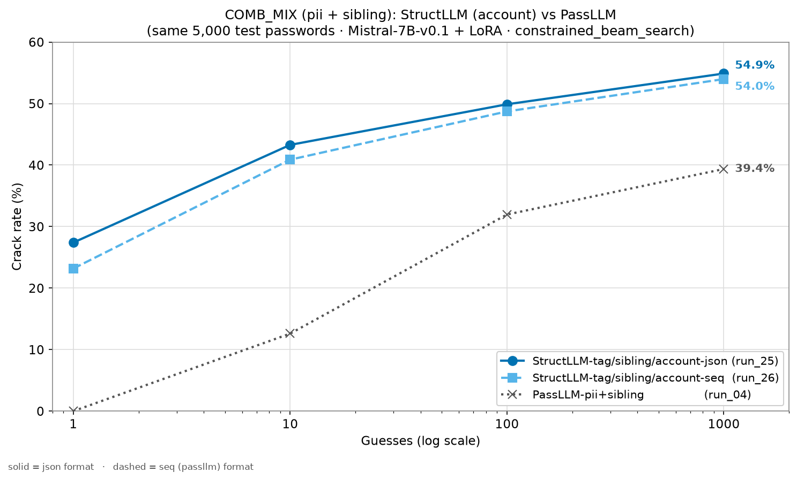
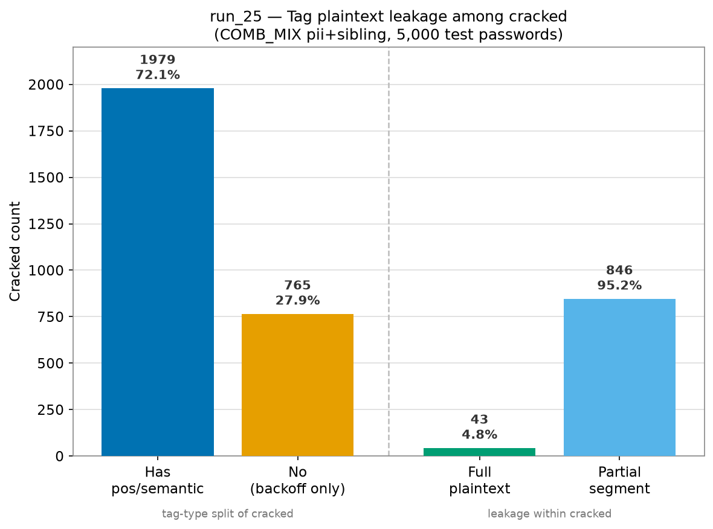

# COMB_MIX（pii + sibling）：StructLLM vs PassLLM 剪報

**資料集：** COMB_MIX（每帳號 ≥1 姊妹密碼 + 帳號/PII 線索）· **基底模型：** Mistral-7B-v0.1 + LoRA（兩方相同底模）· **評估筆數：** 5,000 · **max_guess：** 1,000

| 側 | run | checkpoint | template | 線索 | prompt 格式 | 搜尋法 |
|---|---|---|---|---|---|---|
| **StructLLM-tag/sibling/account-json** | run_25 | `Mistral-7B-v0.1/run_25/lora_final_7100` | id=9 | tag 結構 + sibling + account | JSON | constrained_beam_search（fallback→dynamic） |
| **StructLLM-tag/sibling/account-seq** | run_26 | `Mistral-7B-v0.1/run_26/lora_final_8600` | id=9 | tag 結構 + sibling + account | sequence 串接 | constrained_beam_search（fallback→dynamic） |
| **PassLLM** | run_04 | `mistral_7b_COMB_pii_sibling/final` | id=0 | 帳號 + sibling | sequence 串接 | dynamic_beam_search |

---

## 1. 結果比較

同一組 5,000 筆 COMB_MIX 測試密碼、同底模（Mistral-7B-v0.1 + LoRA）、同搜尋法（`constrained_beam_search`）；命名：`StructLLM-<線索>-<格式>`（線索 = tag/sibling/account；格式 = json 或 seq）。

| K | account-json (run_25) | account-seq (run_26) | PassLLM-pii+sibling (run_04) |
|---:|---:|---:|---:|
| @1    | **27.40%** (1,370) | 23.18% (1,159) | 0.00% (0) |
| @10   | **43.28%** (2,164) | 40.88% (2,044) | 12.60% (630) |
| @100  | **49.88%** (2,494) | 48.72% (2,436) | 31.96% (1,598) |
| @1000 | **54.88%** (2,744) | 53.98% (2,699) | 39.36% (1,968) |

---

## 2. Tag 分析（run_25，5,000 筆）

### 2.1 Tag 類型 × crack rate

| 類別 | 猜中數 | crack rate | @1 | @10 | @100 | @1000 | 該類總數 |
|---|---:|---:|---:|---:|---:|---:|---:|
| 含 pos/semantic（fallback） | 1,979 | 59.30% | 952 | 1,514 | 1,777 | 1,979 | 3,337 |
| 純 backoff（constrained） | 765 | 46.00% | 418 | 650 | 717 | 765 | 1,663 |
| **全部** | **2,744** | **54.88%** | **1,370** | **2,164** | **2,494** | **2,744** | **5,000** |

### 2.2 Fallback 群 Tag 明文洩漏

含明文再細分：**full plaintext**（整串密碼都被 tag 寫出）／**partial segment**（僅部分區段，數字尾碼等仍須模型生成）。

| Tag 含明文 | ├ full | └ partial | Tag 不含明文 | 合計（fallback 猜中） |
|---:|---:|---:|---:|---:|
| 889（44.9%） | 43 | 846 | 1,090（55.1%） | 1,979 |

### 2.3 Tag 分析圖

