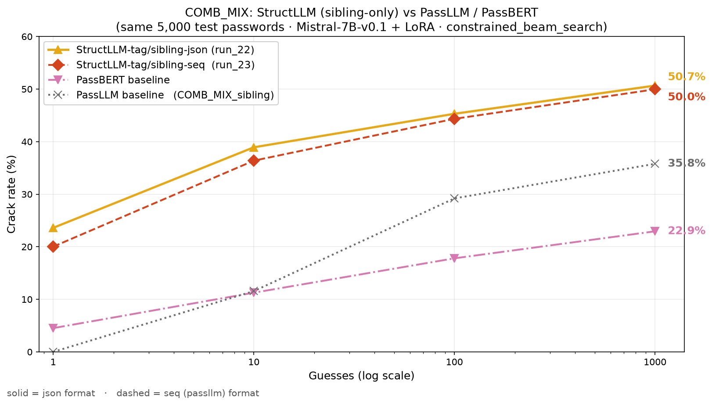
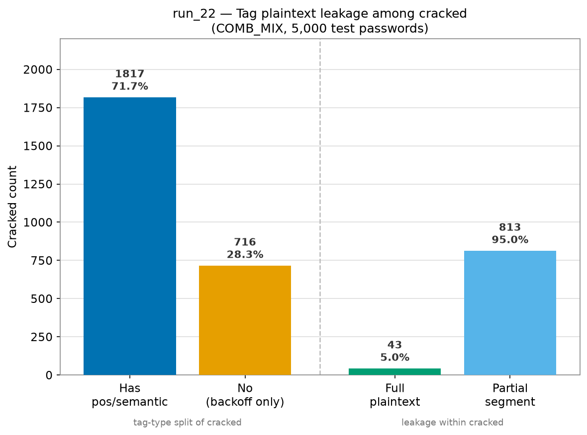

# COMB_MIX：PCFG-LLM vs PassLLM 剪報

**資料集：** COMB_MIX（每帳號 ≥1 姊妹密碼）· **基底模型：** Mistral-7B-v0.1 + LoRA（兩方相同底模）· **評估筆數：** 5,000 · **max_guess：** 1,000

| 側 | run | checkpoint | template | 線索 | prompt 格式 | 搜尋法 |
|---|---|---|---|---|---|---|
| **StructLLM-tag/sibling-json** | run_22 | `Mistral-7B-v0.1/run_22/lora_final_7200` | id=7 | tag 結構 + sibling | JSON list | constrained_beam_search（fallback→dynamic） |
| **StructLLM-tag/sibling-seq** | run_23 | `Mistral-7B-v0.1/run_23/lora_final_7400` | id=9 | tag 結構 + sibling | sequence 串接 | constrained_beam_search（fallback→dynamic） |
| **PassLLM** | COMB_MIX_sibling | `mistral_7b_COMB_MIX_sibling/final` | id=0 | 帳號 + sibling | sequence 串接 | dynamic_beam_search |
| **PassBERT** | — | — | — | — | — | 外部基線（masked-LM） |

---

## 1. 結果比較

同一組 5,000 筆 COMB_MIX 測試密碼、同底模（Mistral-7B-v0.1 + LoRA，PassBERT 除外）、同搜尋法（`constrained_beam_search`）；命名：`StructLLM-<線索>-<格式>`（線索 = tag/sibling；格式 = json 或 seq）。

| K | sibling-json (run_22) | sibling-seq (run_23) | PassBERT | PassLLM (COMB_MIX_sibling) |
|---:|---:|---:|---:|---:|
| @1    | **23.60%** (1,180) | 20.02% (1,001) | 4.52% (226) | 0.00% (0) |
| @10   | **38.92%** (1,946) | 36.38% (1,819) | 11.26% (563) | 11.56% (578) |
| @100  | **45.30%** (2,265) | 44.34% (2,217) | 17.80% (890) | 29.20% (1,460) |
| @1000 | **50.66%** (2,533) | 49.96% (2,498) | 22.94% (1,147) | 35.78% (1,789) |

---

## 2. Tag 分析（run_22，5,000 筆）

### 2.1 Tag 類型 × crack rate

| 類別 | 猜中數 | crack rate | @1 | @10 | @100 | @1000 | 該類總數 |
|---|---:|---:|---:|---:|---:|---:|---:|
| 含 pos/semantic（fallback） | 1,817 | 54.45% | 795 | 1,334 | 1,596 | 1,817 | 3,337 |
| 純 backoff（constrained） | 716 | 43.05% | 385 | 612 | 669 | 716 | 1,663 |
| **全部** | **2,533** | **50.66%** | **1,180** | **1,946** | **2,265** | **2,533** | **5,000** |

### 2.2 Fallback 群 Tag 明文洩漏

含明文再細分：**full plaintext**（整串密碼都被 tag 寫出）／**partial segment**（僅部分區段，數字尾碼等仍須模型生成）。

| Tag 含明文 | ├ full | └ partial | Tag 不含明文 | 合計（fallback 猜中） |
|---:|---:|---:|---:|---:|
| 856（47.1%） | 43 | 813 | 961（52.9%） | 1,817 |

### 2.3 Tag 分析圖

