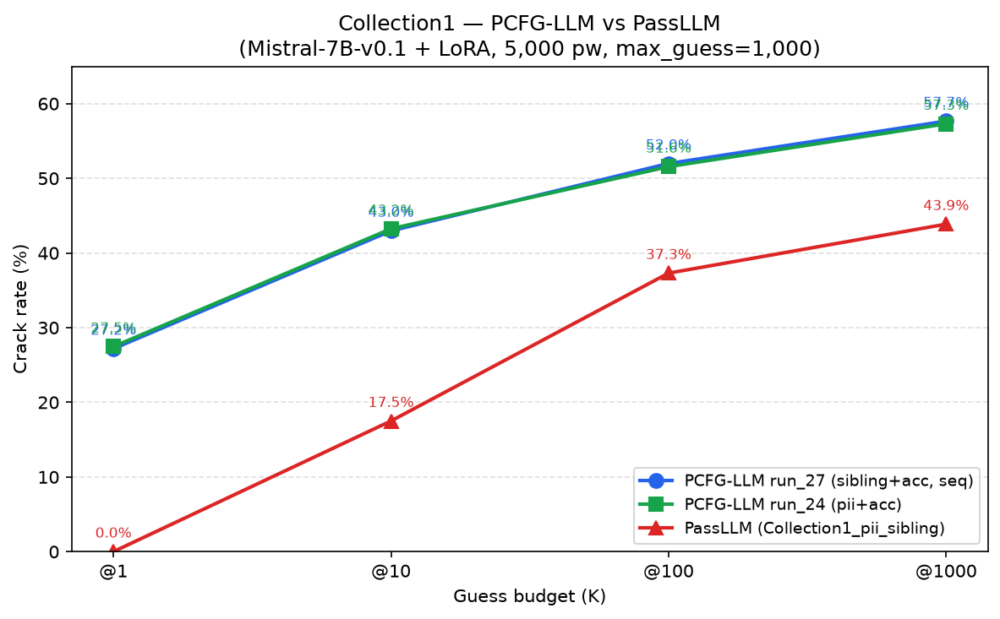
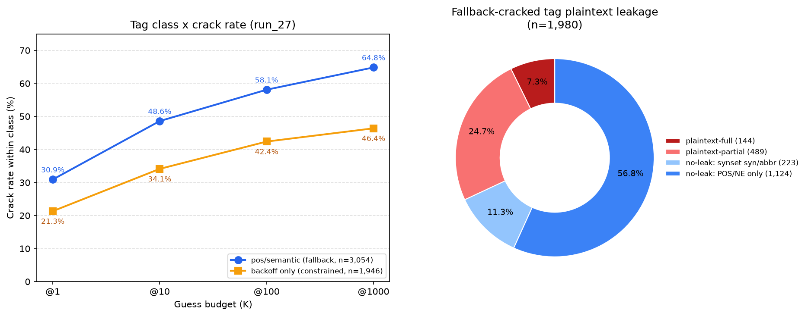

# Collection1：PCFG-LLM vs PassLLM 剪報

**資料集：** Collection1（帳號 + PII / 姊妹密碼）· **基底模型：** Mistral-7B-v0.1 + LoRA（兩方相同底模）· **評估筆數：** 5,000 · **max_guess：** 1,000

| 側 | run | checkpoint | template | 線索 | prompt 格式 | 搜尋法 |
|---|---|---|---|---|---|---|
| **PCFG-LLM run_27** | run_27 | `Mistral-7B-v0.1/run_27/lora_final_5900` | id=9 | tag 結構 + 帳號 + sibling | sequence 串接 | constrained_beam_search（fallback→dynamic） |
| **PCFG-LLM run_24** | run_24 | `Mistral-7B-v0.1/run_24/lora_final_5600` | id=9 | tag 結構 + 帳號 + PII | sequence 串接 | constrained_beam_search（fallback→dynamic） |
| **PassLLM** | Collection1_pii_sibling | `mistral_7b_Collection1_pii_sibling_concat/final` | id=0 | 帳號 + sibling | sequence 串接 | dynamic_beam_search |

---

## 1. 結果比較

同一組 5,000 筆 Collection1 測試密碼、同底模（Mistral-7B-v0.1 + LoRA）、max_guess=1,000。

| K | PCFG-LLM run_27（sibling+acc） | PCFG-LLM run_24（pii+acc） | PassLLM（Collection1_pii_sibling） |
|---:|---:|---:|---:|
| @1    | **27.18%** (1,359) | 27.46% (1,373) | 0.00% (0) |
| @10   | 42.96% (2,148) | **43.24%** (2,162) | 17.50% (875) |
| @100  | **51.98%** (2,599) | 51.56% (2,578) | 37.30% (1,865) |
| @1000 | **57.66%** (2,883) | 57.30% (2,865) | 43.86% (2,193) |

---

## 2. Tag 分析（run_27，5,000 筆）

### 2.1 Tag 類型 × crack rate

| 類別 | 猜中數 | crack rate | @1 | @10 | @100 | @1000 | 該類總數 |
|---|---:|---:|---:|---:|---:|---:|---:|
| 含 pos/semantic（fallback） | 1,980 | 64.83% | 944 | 1,484 | 1,774 | 1,980 | 3,054 |
| 純 backoff（constrained） | 903 | 46.40% | 415 | 664 | 825 | 903 | 1,946 |
| **全部** | **2,883** | **57.66%** | **1,359** | **2,148** | **2,599** | **2,883** | **5,000** |

### 2.2 Fallback 群 Tag 明文洩漏

含明文再細分：**full plaintext**（整串密碼都被 tag 寫出）／**partial segment**（僅部分區段，數字尾碼等仍須模型生成）。

| Tag 含明文 | ├ full | └ partial | Tag 不含明文 | 合計（fallback 猜中） |
|---:|---:|---:|---:|---:|
| 633（32.0%） | 144 | 489 | 1,347（68.0%） | 1,980 |

### 2.3 Tag 分析圖

