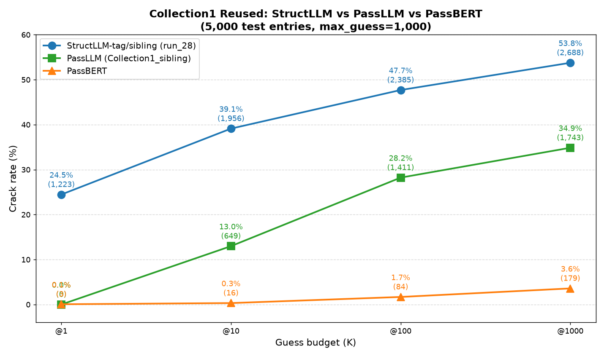

# Collection1：PCFG-LLM 剪報

**資料集：** Collection1（每帳號 ≥1 姊妹密碼）· **基底模型：** Mistral-7B-v0.1 + LoRA · **評估筆數：** 5,000 · **max_guess：** 1,000

| 側 | run | checkpoint | template | 線索 | prompt 格式 | 搜尋法 |
|---|---|---|---|---|---|---|
| **StructLLM-tag/sibling-json** | run_28 | `Mistral-7B-v0.1/run_28/lora_final_3400` | id=7 | tag 結構 + sibling | JSON list | constrained_beam_search（fallback→dynamic） |
| **StructLLM-tag/sibling-seq** | — | — | — | — | — | 待評估 |
| **PassLLM** | — | `mistral_7b_Collection1_sibling/final` | id=0 | account info（sibling/PII） | 連接字串 | dynamic_beam_search |
| **PassBERT** | — | — | — | — | — | 外部基線（masked-LM） |

> 來源（StructLLM）：`eval-388930.out`（run_eval，checkpoint-3400 = eval loss 最低的 best；輸出 `gen/eval_results_id7_run_28_Mist7B_id7_Collection1_sibling_constrain_5000.jsonl`）。
>
> 來源（PassLLM）：`results/passllm/Collection1_sibling/eval-390658.out`（lora `checkpoints/mistral_7b_Collection1_sibling/final`，prompt id=0，`dynamic_beam_search`，beam 95→1000；輸出 `gen/passllm/Collection1_sibling/input_output.jsonl`）。

---

## 1. 結果比較

5,000 筆 Collection1 測試密碼、Mistral-7B-v0.1 + LoRA、`constrained_beam_search`（含 pos/semantic tag 時 fallback→dynamic_beam_search）。

| K | sibling-json (run_28) | sibling-seq | PassBERT | PassLLM (Collection1_sibling)|
|---:|---:|---:|---:|---:|
| @1    | **24.46%** (1,223) | — | 0.06% (3) | 0.00% (0) |
| @10   | **39.12%** (1,956) | — | 0.32% (16) | 12.98% (649) |
| @100  | **47.70%** (2,385) | — | 1.68% (84) | 28.22% (1,411) |
| @1000 | **53.76%** (2,688) | — | 3.58% (179) | 34.86% (1,743) |

---

## 2. Tag 分析（run_28，5,000 筆）

### 2.1 Tag 類型 × crack rate

分類：**含 pos/semantic**（觸發 fallback→dynamic）／**純 backoff**（走 constrained_beam_search）。ALL 列與第 1 節官方數字一致。

| 類別 | 猜中數 | crack rate | @1 | @10 | @100 | @1000 | 該類總數 |
|---|---:|---:|---:|---:|---:|---:|---:|
| 含 pos/semantic（fallback） | 1,840 | 60.25% | 828 | 1,334 | 1,623 | 1,840 | 3,054 |
| 純 backoff（constrained） | 848 | 43.58% | 395 | 622 | 762 | 848 | 1,946 |
| **全部** | **2,688** | **53.76%** | **1,223** | **1,956** | **2,385** | **2,688** | **5,000** |

### 2.2 Fallback 群 Tag 明文洩漏

含明文再細分：**full plaintext**（整串密碼都被 tag 寫出）／**partial segment**（僅部分區段，其餘仍須模型生成）。

> ⚠️ 判定方式為重建版（逐段比對 token 與 tag 是否寫出該段字元），與 COMB_MIX 報告的實作可能略有差異，數字僅供參考。

| Tag 含明文 | ├ full | └ partial | Tag 不含明文 | 合計（fallback 猜中） |
|---:|---:|---:|---:|---:|
| 641（34.8%） | 147 | 494 | 1,199（65.2%） | 1,840 |

### 2.3 Tag 分析圖

<!--  圖表待補 -->
