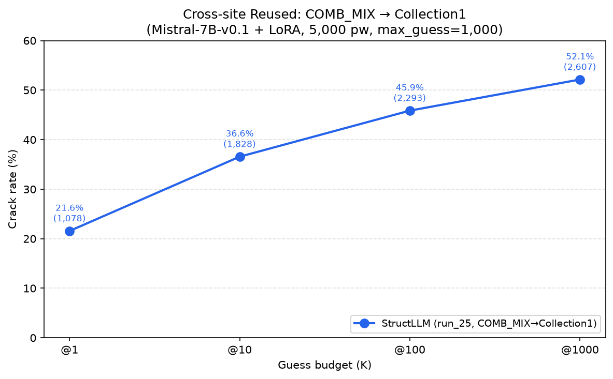

# Cross-site 實驗

## Reused

### COMB_MIX → Collection1

訓練站 COMB_MIX，跨站測試 Collection1（sibling + account 線索）；5,000 筆、Mistral-7B-v0.1 + LoRA、max_guess=1,000。

| K | StructLLM（run_25, COMB_MIX→Collection1） | PassLLM | PassBERT |
|---:|---:|---:|---:|
| @1    | 21.56% (1,078) | _留白_ | _留白_ |
| @10   | 36.56% (1,828) | _留白_ | _留白_ |
| @100  | 45.86% (2,293) | _留白_ | _留白_ |
| @1000 | 52.14% (2,607) | _留白_ | _留白_ |

---

## PII + Sibling

