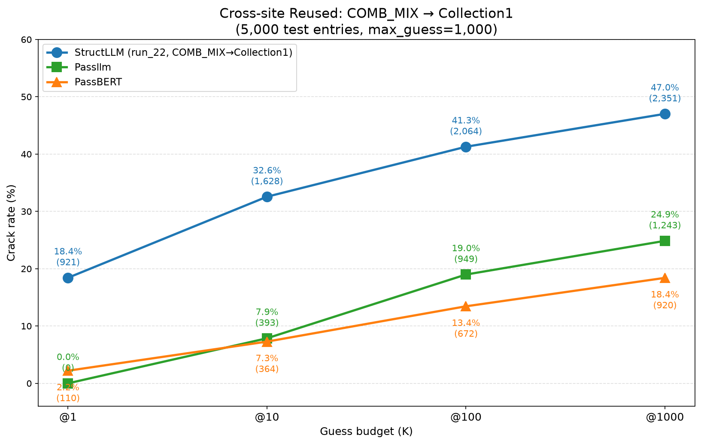
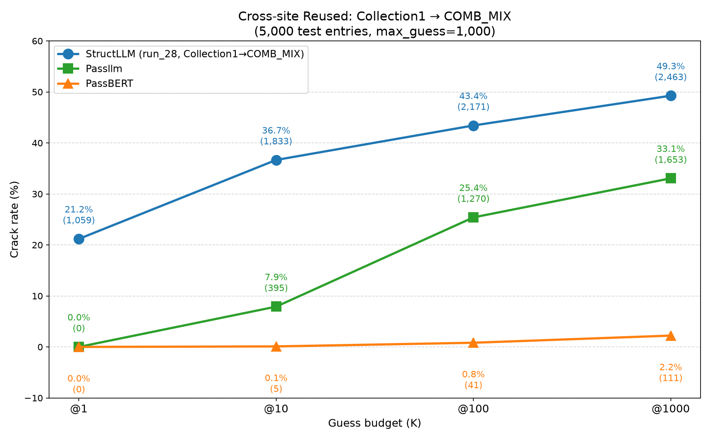
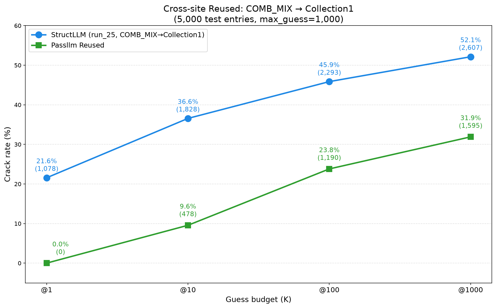

# Cross-site 實驗

## Reused

### COMB_MIX → Collection1

訓練站 COMB_MIX，跨站測試 Collection1（sibling + account 線索）；5,000 筆、Mistral-7B-v0.1 + LoRA、max_guess=1,000。

| K | StructLLM（run_22, COMB_MIX→Collection1） | Passllm | PassBERT |
|---:|---:|---:|---:|
| @1    | 18.42% (921) | 0.00% (0) | 2.20% (110) |
| @10   | 32.56% (1,628) | 7.86% (393) | 7.28% (364) |
| @100  | 41.28% (2,064) | 18.98% (949) | 13.44% (672) |
| @1000 | 47.02% (2,351) | 24.86% (1,243) | 18.40% (920) |

> StructLLM 來源：`eval-399236.out`（run_22, lora_final_7200；分母 5,000）。其中 64 筆（1.28%）因 CUDA OOM 被記為未破解，故 crack rate 為下限。
> Passllm 來源：`results/passllm/cross-site/COMBMIX_Collection1_sibling/eval-399260.out`（分母 5,000；另有 @50 16.36% (818)、@500 23.36% (1,168)）。

### Collection1 → COMB_MIX

訓練站 Collection1，跨站測試 COMB_MIX（sibling + account 線索）；5,000 筆、Mistral-7B-v0.1 + LoRA、max_guess=1,000。

| K | StructLLM（run_28, Collection1→COMB_MIX） | Passllm | PassBERT |
|---:|---:|---:|---:|
| @1    | 21.18% (1,059) | 0.00% (0) | 0.00% (0) |
| @10   | 36.66% (1,833) | 7.90% (395) | 0.10% (5) |
| @100  | 43.42% (2,171) | 25.40% (1,270) | 0.82% (41) |
| @1000 | 49.26% (2,463) | 33.06% (1,653) | 2.22% (111) |

> StructLLM 來源：`results/eval/eval-391726.out`（分母 5,000）。
> Passllm 來源：`results/passllm/cross-site/Collection1_COMBMIX_sibling/eval-391776.out`（分母 5,000；另有 @50 18.52% (926)、@500 31.32% (1,566)）。

---

## PII + Sibling

### COMB_MIX → Collection1

訓練站 COMB_MIX，跨站測試 Collection1（sibling + account 線索）；5,000 筆、Mistral-7B-v0.1 + LoRA、max_guess=1,000。

| K | StructLLM（run_25, COMB_MIX→Collection1） | Passllm Reused ‡ |
|---:|---:|---:|
| @1    | 21.56% (1,078) | 0.00% (0) | 
| @10   | 36.56% (1,828) | 9.56% (478) |
| @100  | 45.86% (2,293) | 23.80% (1,190) | 
| @1000 | 52.14% (2,607) | 31.90% (1,595) | 

> ‡ Passllm Reused 來源：`results/passllm/cross-site/COMBMIX_Collection1/eval-387031_pii_sibling.out`（分母 5,000；另有 @50 19.72% (986)、@500 29.96% (1,498)）。

---

