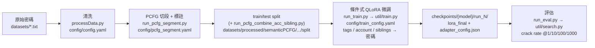
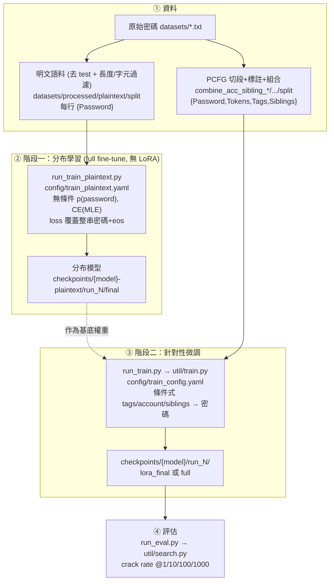

# 系統架構說明文件

LLM PCFG 密碼生成系統 —— 以 PCFG tag 結構引導 LLM 生成針對性候選密碼。

本文件描述兩種訓練架構：

- **OLD（一條式）**：資料 → 單一條件式微調 → 評估。
- **NEW（兩階段式）**：先用海量明文學「密碼分布」，再用條件資料特化成「針對性生成」。

> Mermaid 圖需 Mermaid preview 外掛才會渲染；可另匯出成 PNG 置於 `docs/images/`。
> BPE pipeline（`trainBPE.py` / `run_tokenize.py`）為 legacy 基線，不在本圖內。

---

## OLD：一條式架構

單一訓練階段，直接學「給 tag 結構 → 生成符合結構的密碼」的條件任務。



- **訓練**：QLoRA（4-bit NF4 + `paged_adamw_8bit`），loss 只算密碼（assistant）token。
- **特點**：一步到位；但條件資料（帶 tags/siblings）量有限，模型對通用密碼分布的學習受限。

---

## NEW：兩階段式架構

把「學分布」與「學條件任務」拆開：**階段一**全參數微調吃海量純明文，學無條件分布 `p(password)`；**階段二**接續階段一的權重，用條件資料做針對性微調。



- **階段一**：base LLM → 全參數微調純明文（~274 萬筆）。目標函數 = causal-LM cross-entropy，等價於最小化模型與真實密碼分布的 KL；指標看 `eval_loss` / perplexity。
- **階段二**：把 `config/train_config.yaml` 的 `model_path`/`model_name` 指向階段一輸出 `final/`，再跑原本的條件式微調（LoRA 或 full）。
- **為什麼兩階段**：先用大量明文學通用字元/長度/常見模式，再用較少的條件資料特化 → 資料效率更高、避免條件資料稀少時過擬合，有助提升 crack rate。

---

## 兩者差異對照

| 項目 | OLD 一條式 | NEW 兩階段式 |
|---|---|---|
| 訓練階段 | 1 | 2（分布學習 → 針對性微調） |
| 階段一 | — | 純明文全參數微調，無條件 CE |
| 主訓練 | 條件式 QLoRA | 階段二條件式微調（接續階段一權重） |
| 訓練資料 | 條件式 JSONL | 明文語料 + 條件式 JSONL |
| 入口腳本 | `run_train.py` | `run_train_plaintext.py` → `run_train.py` |
| 設定檔 | `config/train_config.yaml` | `config/train_plaintext.yaml` → `config/train_config.yaml` |
| 目標 | 直接學條件生成 | 先學分布，再特化 |

---

## 關鍵檔案 / 設定對照

| 檔案 | 階段 | 說明 |
|---|---|---|
| `config/config.yaml` | 資料 | 密碼清洗（長度/字元/去重） |
| `config/pcfg_segment.yaml` | 資料 | PCFG 切段 + 標註 + 切分 |
| `datasets/processed/plaintext/split/` | NEW 階段一 | 明文分布學習資料（`{Password}`） |
| `config/train_plaintext.yaml` | NEW 階段一 | full FT 超參（無 LoRA、LR 1e-5、CE） |
| `run_train_plaintext.py` | NEW 階段一 | 無條件分布學習腳本 |
| `config/train_config.yaml` | 訓練 | 條件式微調超參 + LoRA + dataset_path |
| `config/knowledge_format.yaml` | 訓練 | prompt 知識欄位（id=9 account+sibling） |
| `util/pw_tokenize.py` | 訓練 | 95-char 編碼 + label masking |
| `config/search.yaml` | 評估 | `search_type` + eval 設定 |
| `run_eval.py` / `util/search.py` | 評估 | 搜尋 → crack rate @K |

---

## 資料格式

```json
// 條件式（semanticPCFG / combine_acc_sibling）
{"Password":"dragon99!","Tokens":"dragon|99|!","Tags":"nn|number2|special1","source":"000webhost"}

// 明文分布學習（plaintext，NEW 階段一）
{"Password":"dragon99!"}
```

- **tag 型別**：`backoff`（結構，100% 覆蓋）> `pos`（CLAWS7 詞性）> `pos_semantic`（WordNet synset + 命名實體）。
- **基底模型**：`models/Mistral-7B-v0.1`（現行實驗）或 `models/Qwen3-4B`。
