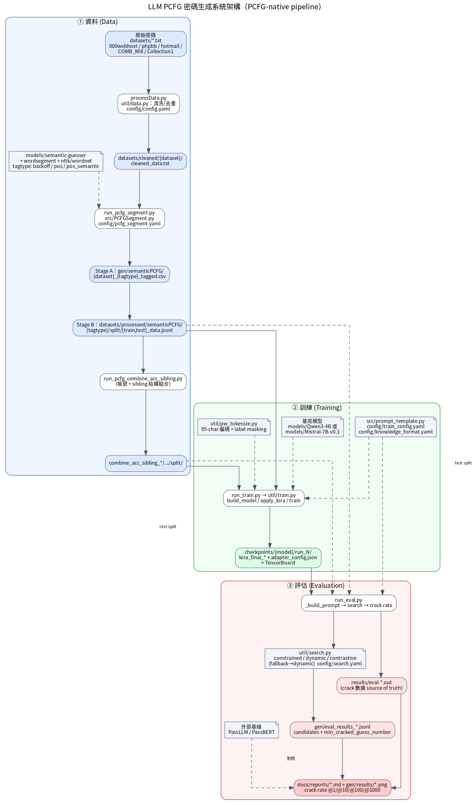
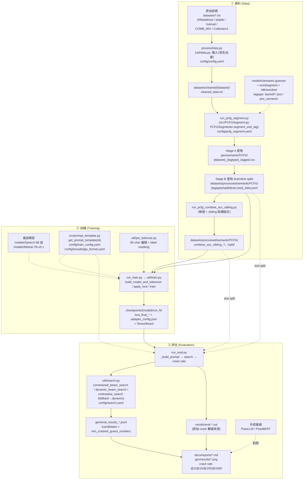

# 系統架構說明文件

LLM PCFG 密碼生成系統 —— 以 PCFG tag 結構引導 LLM 生成針對性候選密碼。
本文件描述現行 **PCFG-native pipeline（Pipeline B）** 的三個階段：**資料 → 訓練 → 評估**。

> BPE pipeline（`trainBPE.py` / `run_tokenize.py` / `src/BPE.py` / `src/Tokenize.py`）為 legacy 基線，現行流程不使用，故不在本圖內。

---

## 系統架構圖

Mermaid 原始碼（可編輯；需 Mermaid preview 外掛才會渲染）

---

## 架構說明

### ① 資料 (Data)

把原始明文密碼轉成「**Tokens + Tags**」的訓練樣本。

| 步驟 | 腳本 / 模組 | 輸入 → 輸出 | 設定 |
|---|---|---|---|
| 清洗 | `processData.py`（`util/data.py`） | `datasets/*.txt` → `datasets/cleaned/{dataset}/cleaned_data.txt` | `config/config.yaml` |
| 切段 + 標註（Stage A） | `run_pcfg_segment.py`（`src/PCFGSegment.py`） | cleaned → `gen/semanticPCFG/{dataset}_{tagtype}_tagged.csv` | `config/pcfg_segment.yaml` |
| 切分 train/test（Stage B） | `run_pcfg_segment.py` | CSV → `datasets/processed/semanticPCFG/{tagtype}/split/{train,test}_data.jsonl` | 同上 |
| 結構組合（選用） | `run_pcfg_combine_acc_sibling.py` | split → `combine_acc_sibling_*/.../split/` | — |

- **切段**：依字元類別邊界切（`dragon|99|!`），與 PCFG tag 語意對齊（有別於 BPE 依頻率切的 `drag|on|99|!`）。
- **外部相依**：`models/semantic-guesser`（PCFG 標註器,須手動 clone）、`wordsegment`、`nltk` wordnet corpus。
- **三種 tag 型別**：`backoff`（結構,100% 覆蓋）> `pos`（CLAWS7 詞性）> `pos_semantic`（WordNet synset + 命名實體）。
- **JSONL 格式**：`{"Password","Tokens","Tags","source"}`，例如
  `{"Password":"dragon99!","Tokens":"dragon|99|!","Tags":"nn|number2|special1","source":"000webhost"}`。

### ② 訓練 (Training)

用 QLoRA 微調基底 LLM,讓模型「看 tag 結構 → 生成符合該結構的密碼」。

- **入口**：`run_train.py` → `util/train.py`（`build_model_and_tokenizer` → `apply_lora` → `train`，HF Trainer）。
- **基底模型**：`models/Qwen3-4B`（CLAUDE.md 預設）或 `models/Mistral-7B-v0.1`（現行實驗所用）。
- **微調法**：QLoRA（4-bit NF4 + `paged_adamw_8bit`）。
- **Prompt**：`src/prompt_template.py` 的 `get_prompt_template(id)`；由 `config/train_config.yaml` 指定 template id（如 id=3 placeholder、id=7/9 等），知識欄位由 `config/knowledge_format.yaml` 控制。
- **編碼**：`util/pw_tokenize.py` 做 95-char 編碼與 label masking（loss 只算 assistant token）。
- **產物**：`checkpoints/{model}/run_N/lora_final_*`（含 `adapter_config.json`）+ TensorBoard 記錄。

### ③ 評估 (Evaluation)

模擬「只給 Tags、不給字元」的針對性猜測:模型能否重建出真實密碼。

- **入口**：`run_eval.py` —— 讀 test JSONL → `_build_prompt()` → 搜尋 → 每筆最多 1,000 個排序候選 → `min_cracked_guess_number`（0 = 未猜中）。
- **搜尋**（`util/search.py`,由 `config/search.yaml` 的 `search_type` 選）：
  - `constrained_beam_search`：純 backoff tag 用 `build_step_constraints` 做硬約束解碼;遇到 pos/semantic tag 自動 **fallback → dynamic_beam_search**。
  - 另有 `dynamic_beam_search`、`contrastive_search` 變體。LoRA 由 `adapter_config.json` 自動偵測。
- **輸出**：
  - `gen/eval_results_*.jsonl`（index、real_password、tokens、tags、candidates、min_cracked_guess_number）。
  - `results/eval-*.out`（HPC job stdout,**crack 數據的 source of truth**）。
- **指標**：crack rate @K（K = 1 / 10 / 100 / 1000）。
- **報告**：`docs/reports/*.md` + `gen/results/*.png`（crack rate 折線圖、tag 型別分佈）;常與外部基線 **PassLLM / PassBERT** 對照。

---

## 設定檔對照

| 設定檔 | 用於階段 | 說明 |
|---|---|---|
| `config/config.yaml` | 資料（+ 共用） | 密碼清洗;另被 eval/search/train 讀取,非純 BPE |
| `config/pcfg_segment.yaml` | 資料 | PCFG-native 切段 + 標註 + 切分 |
| `config/train_config.yaml` | 訓練 | LLM 超參 + LoRA 設定 + dataset_path |
| `config/knowledge_format.yaml` | 訓練 | prompt 知識欄位（如 id=9 account+sibling） |
| `config/search.yaml` | 評估 | `search_type` + eval 設定 |
| `config/tokenize_setting.yaml` | （legacy BPE） | 只被 `src/Tokenize.py` 使用 |
